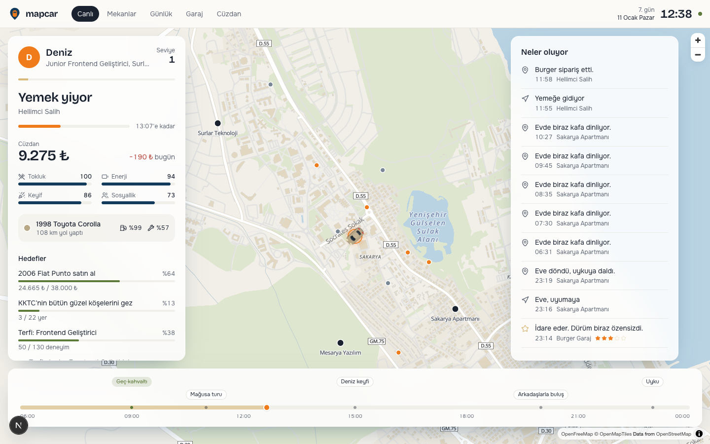
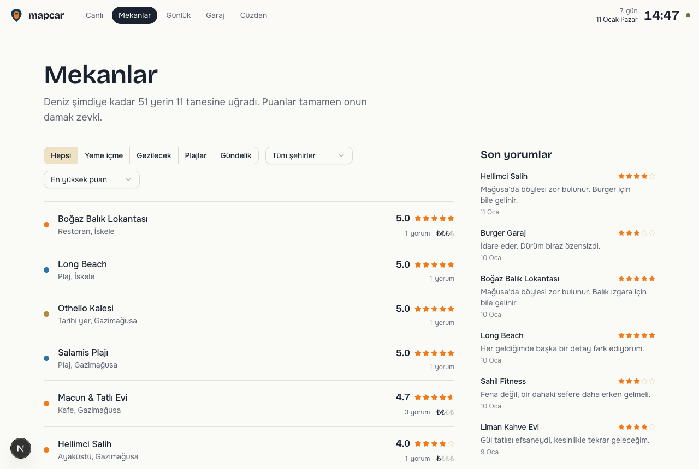
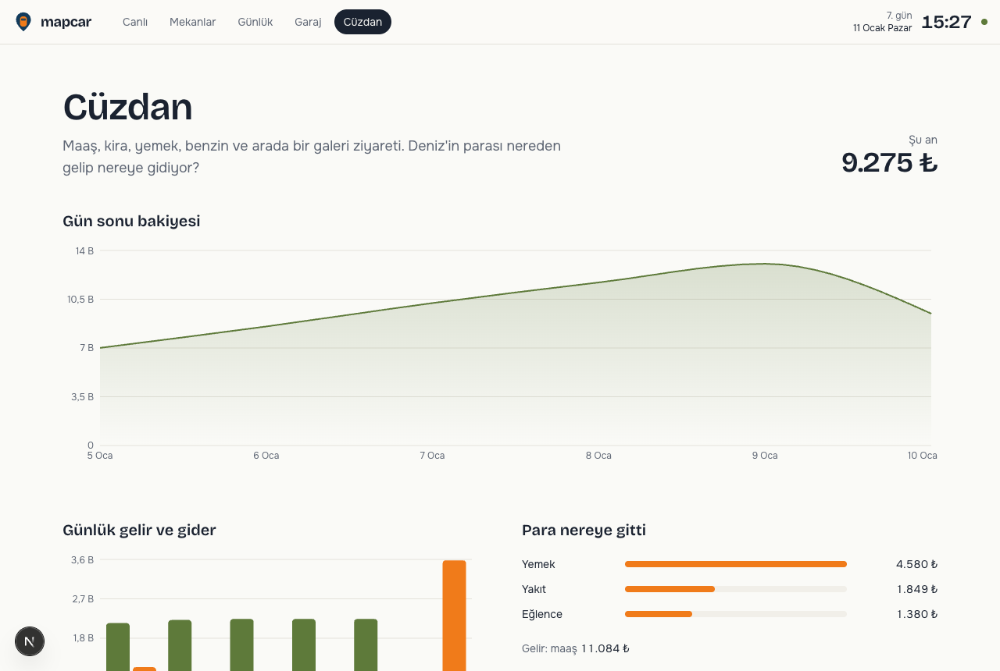
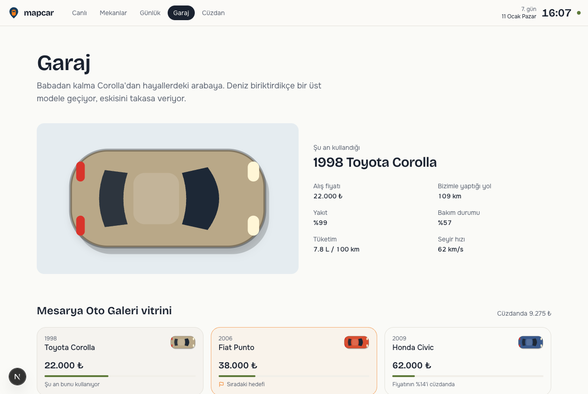
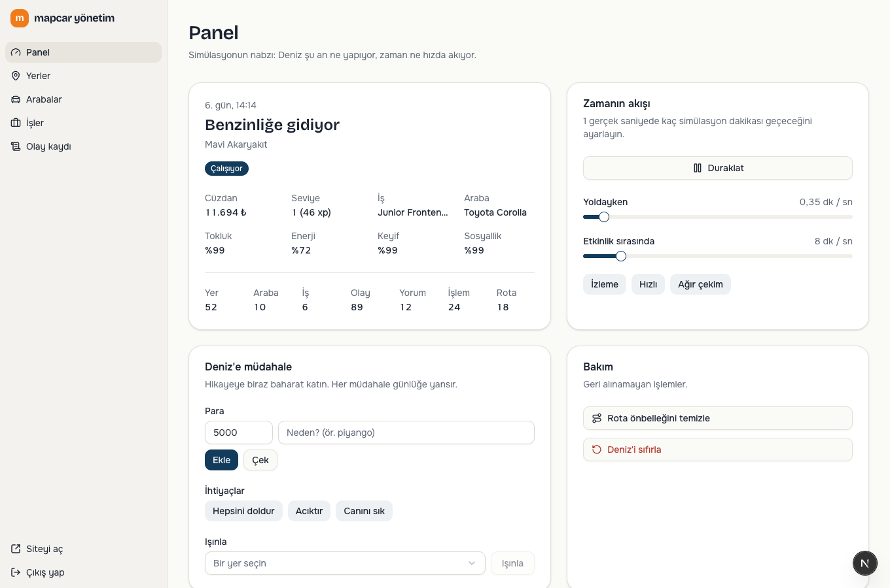

<div align="center">

# mapcar

**Gazimağusa'da kendi hayatını yaşayan sanal bir sürücü.**
Deniz işe gidiyor, para biriktiriyor, araba değiştiriyor, mekanlara puan veriyor. Siz de haritadan canlı izliyorsunuz.



</div>

> _A living simulation of a virtual driver in Famagusta, North Cyprus. A deterministic needs-based engine drives the character around real roads (OpenStreetMap + OSRM). Next.js, Fastify, Prisma and PostgreSQL in a Turborepo monorepo._

## Ne oluyor?

Deniz 24 yaşında, DAÜ Bilgisayar Mühendisliği mezunu. Babasından kalma '98 Corolla'sı ve cebinde 6.000 ₺ ile Mağusa'da hayata atılıyor.

- **İhtiyaçları var.** Açlık, enerji, keyif ve sosyallik zamanla düşüyor. Her an olası eylemleri puanlayıp en mantıklısını seçiyor: işe gitmek, yemek, uyumak, denize girmek ya da arkadaşlarla buluşmak.
- **Çalışıp para kazanıyor.** Barista olarak başlıyor. Akşamları kendini geliştirerek deneyim kazanıyor, seviye atladıkça daha iyi işlere geçiyor ve sonunda CTO olabiliyor.
- **Hedefleri var.** Para biriktirip bir üst model arabayı alıyor, eskisini takasa veriyor. KKTC'nin bütün güzel köşelerini gezmeye çalışıyor. Hafta sonları Girne'ye, Karpaz'a, Lefkoşa'ya kaçıyor.
- **Gerçek yollarda sürüyor.** Rotalar OpenStreetMap verisinden OSRM ile hesaplanıyor, araba gerçek sokaklardan geçiyor.
- **Mekanları puanlıyor.** Her yerin gizli bir kalite puanı var. Deniz bunu bilmiyor, deneyimleyerek öğreniyor, yorum yazıyor ve bir sonraki seçiminde bu deneyimi kullanıyor.
- **Hayat sürprizli.** Lastik patlıyor, benzin bitiyor, patron prim veriyor.

Haritanın ışığı simülasyon saatini izliyor: şafakta turuncu, gece lacivert. Gece yolculuklarında arabanın farları yanıyor.

> Tarihi ve doğal yerler (Othello Kalesi, Salamis, Altın Kum…) gerçek. Restoran, kafe ve iş yerleri ise **kurgusal**: simülasyondaki bir karakterin gerçek işletmelere uydurma puan vermesini istemedik.

## Ekran görüntüleri

| Mekanlar | Cüzdan |
| --- | --- |
|  |  |

| Garaj | Yönetim paneli |
| --- | --- |
|  |  |

## Mimari

```
apps/
  api/        Fastify 5 · simülasyonu çalıştırır, REST + SSE yayınlar, OpenAPI dokümanı (/docs)
  web/        Next.js 16 · canlı harita ve sayfalar (MapLibre, shadcn/ui, Motion)
  admin/      Next.js 16 · yönetim paneli (yer/araba/iş CRUD, zaman ayarı, müdahaleler)
packages/
  sim/        Saf TypeScript simülasyon motoru: deterministik, DB'den bağımsız, testli
  db/         Prisma 7 şeması, migration'lar, dünya verisi ve seed
  contracts/  API sözleşmesi: Zod şemaları (api, web ve admin ortak kullanır)
```



```mermaid
flowchart LR
  subgraph api[apps/api]
    runner[SimRunner<br/>her saniye bir adım] --> engine[packages/sim<br/>advance&#40;&#41;]
    runner --> osrm[(OSRM)]
  end
  runner -- olaylar, işlemler, yorumlar --> pg[(PostgreSQL)]
  runner -- SSE: snapshot, rota, olay --> web[apps/web]
  web -- REST --> api
  admin[apps/admin] -- Bearer token, sunucu tarafında --> api
```

Ayrıntılar için [docs/architecture.md](docs/architecture.md).

**Neden böyle?**

- **Motor saf bir fonksiyon:** `advance(state, world, saniye, ayarlar) → { state, effects }`. Girdiyi değiştirmez, aynı tohumla hep aynı hayatı üretir. Bu yüzden test etmek kolay; veritabanı ve ağ işleri runner'da kalıyor.
- **Zaman uyarlamalı akıyor.** Araba yoldayken zaman yavaş (1 sn ≈ 20 sn), Deniz işteyken ya da uyurken hızlı (1 sn ≈ 8 dk). Böylece sürüş izlenebiliyor, sıkıcı kısımlar çabuk geçiyor. Bir simülasyon günü yaklaşık 4–5 dakika sürüyor.
- **Araba istemcide akıyor.** Sunucu saniyede bir durum gönderiyor; tarayıcı iki durum arasında rota çizgisi üzerinde enterpolasyon yaparak arabayı 60 fps'te kaydırıyor.

## Kurulum

Gerekenler: Node 22+, pnpm 9+, Docker.

```bash
git clone https://github.com/Calpimm/mapcar.git
cd mapcar
pnpm install
cp .env.example .env          # ADMIN_* değerlerini değiştirin
pnpm db:setup                 # postgres + prisma generate + migration + seed
pnpm dev                      # api, web ve admin birlikte
```

| Uygulama | Adres |
| --- | --- |
| Site | http://localhost:3010 |
| Yönetim paneli | http://localhost:3011 (şifre: `.env` içindeki `ADMIN_PASSWORD`) |
| API | http://localhost:4000 |
| API dokümanı | http://localhost:4000/docs |

### Docker ile tam yığın

```bash
docker compose --profile full up -d --build
```

## Komutlar

| Komut | Ne yapar |
| --- | --- |
| `pnpm dev` | Tüm uygulamaları geliştirme modunda başlatır |
| `pnpm build` | Hepsini derler |
| `pnpm test` | Motor ve API testleri |
| `pnpm typecheck` | Tip kontrolü |
| `pnpm lint` / `pnpm format` | Biome ile lint ve biçimlendirme |
| `pnpm db:migrate` | Yeni migration oluşturur ve uygular |
| `pnpm db:seed` | Dünya verisini yükler (tekrar çalıştırmak güvenli) |
| `pnpm db:studio` | Prisma Studio |

## Ortam değişkenleri

| Değişken | Açıklama |
| --- | --- |
| `DATABASE_URL` | PostgreSQL bağlantısı |
| `ADMIN_API_TOKEN` | Admin panelinin API'ye konuştuğu gizli anahtar (≥ 32 karakter) |
| `ADMIN_PASSWORD` | Yönetim paneli şifresi |
| `ADMIN_SESSION_SECRET` | Panel oturum çerezini imzalar (≥ 32 karakter) |
| `OSRM_URL` | Rota servisi. Boş bırakılırsa düz çizgi rotalar kullanılır |
| `NEXT_PUBLIC_API_URL` | Tarayıcının API'ye ulaştığı adres |
| `API_CORS_ORIGINS` | Virgülle ayrılmış izinli kökenler |

## Teknolojiler

TypeScript · pnpm workspaces · Turborepo · Fastify 5 · Zod 4 · Prisma 7 · PostgreSQL 17 · Next.js 16 · React 19 · Tailwind CSS 4 · shadcn/ui · Motion · MapLibre GL · TanStack Query · Zustand · Recharts · Vitest · Biome

Harita verisi © [OpenStreetMap](https://www.openstreetmap.org/copyright) katkıcıları, karolar [OpenFreeMap](https://openfreemap.org), rotalar [OSRM](https://project-osrm.org).

## Katkı

Yeni mekan, araba, olay ya da Deniz'in hayatına yeni bir dert eklemek isterseniz PR'lara açığız. Önce [CONTRIBUTING.md](CONTRIBUTING.md) dosyasına göz atın.

## Lisans

[MIT](LICENSE)
